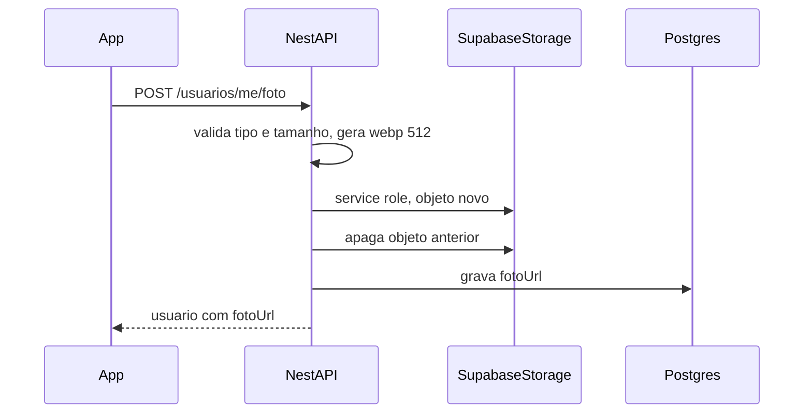
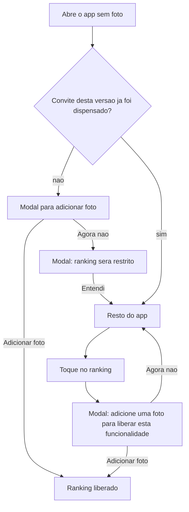

# Design Document — Foto de perfil

## Overview

A foto é opcional para usar o app e obrigatória para ver o ranking. O backend recebe o arquivo, valida, gera um WebP de 512px e grava num bucket público do Supabase. O Postgres guarda só a URL. O frontend desenha um avatar único e trava o ranking quando `fotoUrl` é `null`.

## Storage

- Bucket `avatares`, leitura pública. Escrita só pela service role no backend. Sem policy de insert para `anon` ou `authenticated`.
- Variáveis só no backend: `SUPABASE_URL`, `SUPABASE_SERVICE_ROLE_KEY`, `SUPABASE_STORAGE_BUCKET=avatares`.
- Objeto em `avatares/{usuarioId}/{uuid}.webp`. Cada troca cria um arquivo novo e apaga o anterior.
- O `POST /usuarios/me/foto` não pode ir com `Content-Type: application/json`. O cliente Axios hoje fixa esse header em `src/lib/api-client.ts`; a chamada da foto precisa sobrescrever.

## API

- Coluna `fotoUrl String?` em `Usuario`. `null` no cadastro.
- `fotoUrl` só nestes payloads: `UsuarioPresenter`; `usuario` de `GET /grupos/:grupoId/membros`; `RankingPresenter`; `PontuacaoJogoPresenter` (`GET .../ranking/jogos/:jogoId`). Destaques: preencher `autor.avatar` (campo já existente). `PalpitePresenter` não muda.
- `POST /usuarios/me/foto` e `DELETE /usuarios/me/foto`, autenticados, devolvem o usuário. O delete zera a URL no banco e depois tenta apagar o objeto.
- `PATCH /usuarios/:id` com `fotoUrl` responde 400 (ValidationPipe).
- `DELETE /usuarios/:id` zera a URL e tenta apagar o objeto.
- `GET .../ranking/geral` e `GET .../ranking/fases/:faseId` respondem 403 com `codigo: "RANKING_EXIGE_FOTO"` no `erros[]`. `GET .../ranking/jogos/:jogoId` permanece liberado.
- Ordem segura: objeto novo no Storage → persistir URL → apagar objeto antigo. URL inválida nunca é gravada; órfão antigo é aceitável se a limpeza falhar.

## Frontend

- `AvatarUsuario` em `src/components/usuario/avatar-usuario.tsx`.
- Troca e remoção em `src/app/(protegido)/minha-conta/page.tsx`. Nome e e-mail seguem em `formulario-perfil.tsx`.
- Tipos com `fotoUrl`: `Usuario`, entrada de ranking, membro e detalhamentos com `nomeUsuario`. Depois do POST ou DELETE, atualizar a store de auth.
- Convite de abertura no layout protegido. Chave local sugerida: `bolao.fotoPerfil.conviteVisto`.
- Trava em `src/components/layout/bottom-nav.tsx`, `src/app/(protegido)/ranking/page.tsx` e no `CardRanking` da copa (`aba-dashboard-copa.tsx`). 403 vira estado bloqueado, não erro genérico.
- Superfícies do avatar: Minha Conta, `card-ranking.tsx`, membros, configurações do grupo, `lista-palpites-membros.tsx`, `card-jogo-palpite.tsx`, `card-proximo-jogo-copa.tsx`, `destaque-card.tsx`.

## Fora desta versão

Foto ou descrição de grupo, login social, editor de corte, várias fotos e moderação.
